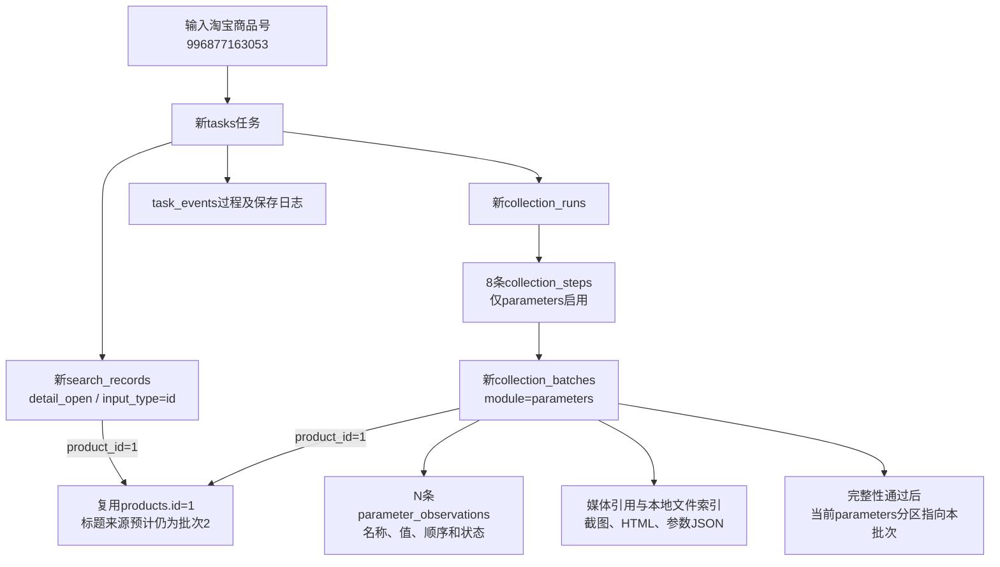

# 第06项：商品ID入口的参数采集测试计划

用途：已执行并人工通过的第06项测试计划。下文拟执行命令和前置范围为执行前方案，结果见[功能验收清单](../功能逐项验收清单.md#06-商品参数采集商品id入口)，不应据此重复启动任务。

日期：2026-10-24。状态：**第06项6条参数已由用户人工确认通过**。本轮进度6/39；用户已授权继续第07项详情链接入口。

## 测试对象与范围

建议沿用第05项第一件商品：淘宝商品号996877163053，已存在products.id=1，列表批次2中的观察id=6，优勤官方旗舰店的粘毛器。执行前再次核对身份及可访问性，遇下架或商品不一致时停止说明，不静默改换商品。

这次使用**商品ID入口，只启用parameters**，采集该商品参数模块实际提供的全部名称和值，数量由页面确定，沿用第05项前8条只是商品选择来源，不限制参数为8项。详情完整链接入口留第07项；视频、主图、SKU、详情图片、评价和问答留各自后续项目。

拟执行命令（仅计划，确认后才运行）：

```cmd
set "TAOBAO_PROJECT=D:\VSCodeProject\taobao_automation_system"
cd /d "%TAOBAO_PROJECT%"
"%TAOBAO_PROJECT%\.venv\Scripts\python.exe" "%TAOBAO_PROJECT%\main.py" taobao detail --input "996877163053" --parameters
```

显式指定--parameters使本次只运行参数模块；不省略功能参数，以免进入默认全部详情模块。

## 执行前准备

1. 先正常收尾第05项浏览器任务并释放资料目录。2026-10-24 10:24只读核对：原任务538c46e0e87045dd97a33bd423766dec为needs_attention，finished_at=NULL，已有44条事件；保存数据后的查看期间出现未预期标签页，正在等待人工反馈。数据验收通过与任务结束分别登记，不强制把运行状态改为succeeded。
2. 保留登录资料、列表批次1/2、原商品及全部观察、原文件。收尾后记录第05项实际结束状态和最终日志；确认没有占用该浏览器目录的活动任务或待补写。
3. 第06项正式启动前重新记录taobao_automation全部业务表数量、相关商品和当前分区、原文件及版本0003_search_origin的基线。此计划不把旧基线冒充下一项执行前基线。

## 页面与文件怎么核对

1. 在可见浏览器按商品ID打开详情，核对地址商品号与目标一致，复用现有淘宝会话；安全验证按实际提示等待人工。
2. 进入参数区域，必要时展开全部，按原页面顺序读取突出参数和普通参数，保留同名项。
3. 核对每项name、name_raw、value、position、status；保留来源source、name_source、value_source、dom_path等。名称与值不能因突出布局反向而错配。
4. 核对summary.total_count、read_count、empty_value_count、error_count、unrecognized_fragment_count及total_count_confirmed。数量动态读取，不预设有几项。
5. 原始参数JSON、模块HTML、详情入口截图及汇总文件保留。比对实际内容、文件大小和SHA-256，区分原始文件与数据库已建立索引的文件。
6. 成功保存后保持详情页供人工查看，提供逐项对照表、真实编号、只读SQL和数据流图。用户可持续提问，确认没有问题后才进入第07项。

## 预计涉及的数据表

以下是正常完成一次参数采集的预期，不是假定已经发生；日志、文件、诊断记录数量以实际基线差异为准。

| 表 | 预计新增/更新 | 本项核对重点 |
|---|---|---|
| tasks | 新增1任务，过程中更新该任务状态/序号 | 新任务、开始/结束时间、最终结果及北京时间 |
| task_events | 新增若干 | 日志连续，保存事件关联真实参数批次，无待补写 |
| products | 复用id=1，预计不新增也不更新标题缓存 | 参数采集不维护显示标题，title_source_batch_id预计仍2 |
| search_records | 新增1条detail_open | input_type=id，商品关联1，入口状态不冒充参数采集结果 |
| collection_runs | 新增1运行，过程中更新汇总 | 同商品同任务，来源运行号与内部id分开 |
| collection_steps | 新增8条步骤记录，更新参数步骤 | parameters的requested=1，其他7项requested=0、not_requested；8条记录不代表执行8模块 |
| collection_batches | 正常新增1个parameters批次 | product_id=1、run_id/step_id归属、scope=product_parameters、实际status和覆盖依据 |
| parameter_observations | 新增N条，N以页面为准 | batch_id、position、名称和值、原文、状态与JSON逐项一致 |
| product_current_sections | 参数完整性通过后，首次新增parameters分区；若已有同范围则更新指针 | 指向本次真实参数批次，部分结果不覆盖已有有效结果 |
| media_references | 新增对应截图、HTML、来源JSON引用，诊断时可能更多 | role、用途位置、文件归属和保存状态 |
| file_assets | 登记被实际引用的本地文件 | 根目录、相对路径、大小、校验及可用性 |
| list_observations及其他明细 | 预计不变 | 原13条列表观察保留，不新增SKU、评价或问答明细 |

本次计划不修改表结构。若出现诊断或中断，按实际记录部分结果、异常与文件，不以预期数量掩盖真实差异。

## 规划中的关联与先后

图中products.id=1、列表批次2为现有真实编号；“新”记录尚未产生，实际测试后用真实id替换并绘制本轮验收图。



先创建任务和详情入口，再建立运行汇总/步骤，读取并保存参数和文件；通过完整性核对后维护参数有效分区，更新步骤及汇总结论。普通日志贯穿过程，浏览器结束后记录任务最终状态。

参数批次的源页面是商品详情。当前程序不会自动继承列表的搜索词或建立列表→参数批次的直接父子外键；它们通过products.id=1查询同商品历史。search_method/search_keyword未提供时应保留NULL，不伪造本次又执行了粘毛器搜索。

## 通过标准与异常分支

- 正确商品且只执行参数模块；参数名称和值配对、条数、顺序及同名项保留正确。
- 明确空值用empty_value；缺值节点、未知结构、未加载分别说明，不能用0或空结果替代。
- 正常完整结果须有可靠完整性依据，当前分区指向正确批次；部分结果保留历史并停止核对，不误发布。
- 页面明确无参数时如实记录no_parameters，该空态不替代“有参数明细”的分支覆盖；是否另选商品由用户确认。
- 数据库与原JSON、HTML、页面及日志对应，用户理解并确认后才标本项通过。

## 交付给用户的材料

本轮执行前后快照、逐表新增/修改/删除数量、所有修改字段前后值、参数逐项对应表、文件核对结果、真实任务/运行/步骤/批次/观察编号及流程图、可复制只读SQL。新发现或改变的业务取值统一补入[数据库字段取值说明](../数据库字段取值说明.md)。

执行记录：第05项已于2026-10-24 10:30:57正常收尾，执行状态如实记录cancelled；10:33:07保存第06项新基线。用户已授权开始本项，实际结果及证据继续登记在[逐项验收清单](../功能逐项验收清单.md)。

实际结果：任务61d9de5e925f4e588b9e31cb35b91c9d，参数批次3，运行1、步骤4，保存6条read参数；仅参数模块启用，原商品及列表历史不变。[真实字段、增量、流程图及查询](../../workspace/output/reports/manual_acceptance_20261024/06_parameters_20261024_103307.md)。页面保留供人工查看，用户未确认前不推进。
