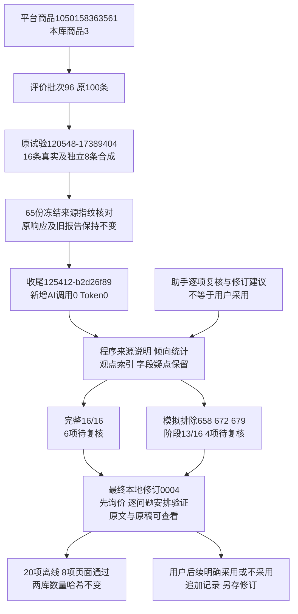

# 评价报告离线收尾实施记录

日期：2026-10-30。用户批准“剩余问题＋额外优化”的五步执行方案后完成。本轮为已有返回的程序处理、助手内容复核和本地阅读收尾，不是提示词V1.3，也没有再次请求模型。**新增AI调用0次、Token0，10项方向/反证待用户复核，正式Web/MySQL未接入。**

## 范围和身份

新增tests/report_closeout，原V1.2提示、契约、处理核心及原试验120548-17389404完整保留。65份源试验/原工具/提示文件前后SHA256一致；没有改旧原文、响应、处理结果、HTML或原离线日志。

本轮收尾编号125412-b2d26f89，根目录workspace/output/reports/review_report_closeout/20261030/125412-b2d26f89/，最终阅读入口revisions/0004/index.html。0001～0003是本地开发展示修订，均保留，没有额外模型调用或自动覆盖。0004为完成20项离线及8项页面核对的本轮交付。

平台商品1050158363561对应本库products.id=3；collection_batches.id=96是2026-10-26 10:11:58的评价采集批次，原100条达到上限。沿用16条目的性样例：601、602、603、604、605、610、618、624、646、658、663、672、679、694、696、699；编号为review_observations.id，不是独立买家身份。完整16/16，阶段模拟排除658/672/679后13/16；不是旧正式任务新增失败。

## 十项问题的实际处理

| 问题 | 本轮具体结果 | 仍需明确的边界 |
|---|---|---|
| 反证超原文 | 完整p2的厚度→用量解释列明不充分；p1把反馈当款式差异、把正面猫场景当反证，也逐项说明 | 所有原反证和助手修订都待复核，不声称程序证明语义正确 |
| 自由文字错编号 | 程序从结构化flags/uncertainties/pending/issues生成资料说明，难懂推荐归694，不采用原AI说明中的696 | 原AI错误文字保留在旧稿；不是把原响应偷偷替换成合格 |
| 外观/转述与性能混淆 | 表达视图保留外观、转述、使用自述、期望，标明原疑点和初追评阶段 | 所有自述均未独立验证；900001/900002仍排除原基础统计，只作有疑点表达线索 |
| 提及数易当认可数 | 厚度总2条，正面696、负面663，分别1条；每种倾向/来源有自己的来源集合 | 同条可有不同倾向，分项不能相加；不是买家数或市场比例 |
| 重复证据 | 观点库每个编号只展开一次；完整f7与f3的观点集合相同，改为索引引用 | 保留其他独特发现，不按近似文字自动合并同义主题 |
| 动作不能解决对应问题 | 单卷用量/厚度实测、增加组合数量、包装清洁分别安排 | 组合卷数不等于改善纸薄；包装完整也不能证明干净 |
| 淘汰范围扩大 | 明确当前款、供应商、包装组合等触发范围；当前款不合适不直接暂停整个产品方向 | 是否达到条件需真正询证或实测，尚未执行 |
| 经营核验偏晚 | 报价、基本规格、起订量及补货条件放在拿样安排之前 | 未新增报价/成本/供货事实，不把资料缺口写成供应商没有能力 |
| 首页行动不集中 | 报告先看经营缺口与方向验证清单，逐项列问题、动作、继续/淘汰条件，再查证据和统计 | 顺序是助手提出的安排，不是未经支持的频次排名 |
| 原格式/关联问题 | 沿用严格检查和局部隔离：完整1个统计引用无关联；阶段1段推断类型错误 | 结构问题与局部问题可对应同一位置，不能相加为失败评价数 |

复核时另外确认：完整p2原反证用“完好无损/严实无破损”反驳“纸壳脏”，属性并不一致；阶段p2用正面反馈推出“厚度不足并非普遍”，也超出目的性样本。全部写入单独助手意见，原反证不自动进入已采用结论。

## 新报告的职责与复核状态

程序负责来源身份、范围、统计去重、明确倾向、结构引用、重复观点索引。助手基于已有原文提供四个方向卡片的修订安排与六条反证意见，共10个可单独审核条目；不是新增模型能力测试，也没有把这些判断硬编码成所有产品通用规则。

全部条目默认待复核。用户明确后可登记“已采用/不采用”，保存填写人、意见、时间、来源指纹和候选内容指纹；没有明确确认拒绝登记。来源/候选变化不能沿用旧结论；决定追加保存，可撤回为待复核，新阅读修订也不覆盖旧修订。卡片只有修订建议已采用、相关反证均已作决定后才显示已采用；拒绝反证不会把反证变成已采用。采用报告建议不代表实物性能或经营可行性已验证。

本轮用户尚未逐项审核内容，没有真实人工决定。初次程序检查通过与后续用户采用/实测验收分别记录。

## 离线与回放验证

20项脱敏离线通过：倾向去重不相加、来源分组、时间归属、疑点表达不提升性能、编号由结构来源决定、重复证据索引、原输入不变、默认待复核、候选/来源变化拒绝沿用决定、反证不采用及撤回、明确人工确认、越界引用/动作拒绝、阶段缺口、HTML转义、决定追加、修订不覆盖、冻结来源篡改拒绝、总览状态跟随决定。

真实回放时两个AI客户端创建入口被禁止，读取原返回重建派生后与新修订逐字结构核对一致；原完整61/阶段55项统计的count、review_ids和observation_refs与原输入一致，只增加倾向/来源分布，不伪造新统计结论。

| 回放结果 | 完整样例 | 阶段样例 |
|---|---:|---:|
| 观点表达 | 64 | 55 |
| 方向修订＋反证条目 | 6 | 4 |
| 集中展开的发现集合 | 7（原8个索引保留） | 5 |
| 程序资料说明 | 6 | 8 |
| 纳入/选样记录 | 16/16 | 13/16 |

共119次“观点引用到原文”的核对，去重后56份真实依据，均可在原始片段逐字定位；119不是不同评价数量。合成900001～900008独立表达视图保留，未进入两份真实报告；尺寸缺口提示在阶段相关方向附近可见。

4页×1440/390共8项Playwright检查通过，无横向溢出、断锚点、脚本错误或外部请求；HTML无脚本/iframe和事件属性。实际检查厚度总2/正1负1、阶段缺口、来源引用和凭据排除。查看总览、手机报告截图，补充使用阶段及疑点中文显示后复核通过。qa.json记录实际代码指纹、20项日志、统计对照、状态及页面结果；日志不覆盖旧修订。

## 数据库与旧结果

两库各31张业务表数量、有序内容哈希和版本前后一致，均0013_analysis_recovery。业务新增/修改/删除0，DDL、约束、备注及JSON写值变化0。

| 正式库累计 | 前 | 后 | 本次新增/修改/删除 |
|---|---:|---:|---|
| products | 495 | 495 | 0/0/0 |
| collection_batches | 155 | 155 | 0/0/0 |
| review_observations | 888 | 888 | 0/0/0 |
| analysis_tasks | 2 | 2 | 0/0/0 |
| analysis_sources | 200 | 200 | 0/0/0 |
| analysis_calls | 2 | 2 | 0/0/0 |
| analysis_details | 190 | 190 | 0/0/0 |
| analysis_reports | 3 | 3 | 0/0/0 |
| 全31业务表合计 | 22152 | 22152 | 0/0/0 |

验证库31表全部0→0。旧正式任务0c327dafcdee4fd8945d4f7eca9584d1（93条）和aeb7fe644284493eab6b6904f725d1e1（97条）不变。正式Web仍reviews-v3；没有运行时代码变化，不重启8000服务。Git只提交新工具和说明，不提交业务原文、助手样例意见、凭据或报告。

证据：manifest.json、baseline-hashes.json（65文件）、assistant-assessment.json（本轮助手意见）、database-before/after.json、finish.json，以及0004内revision.json、两份派生JSON、表达视图、四份HTML、offline-tests.log、qa.json和截图。各版与原稿均保留；完整使用和人工登记命令见[工具说明](../../tests/report_closeout/README.md)。

本轮收尾完成但尚未通过用户内容验收。下一步先阅读报告并确认价值及具体意见；正式接入、新商品验证或新付费请求仍须另行方案，不自动推进。
