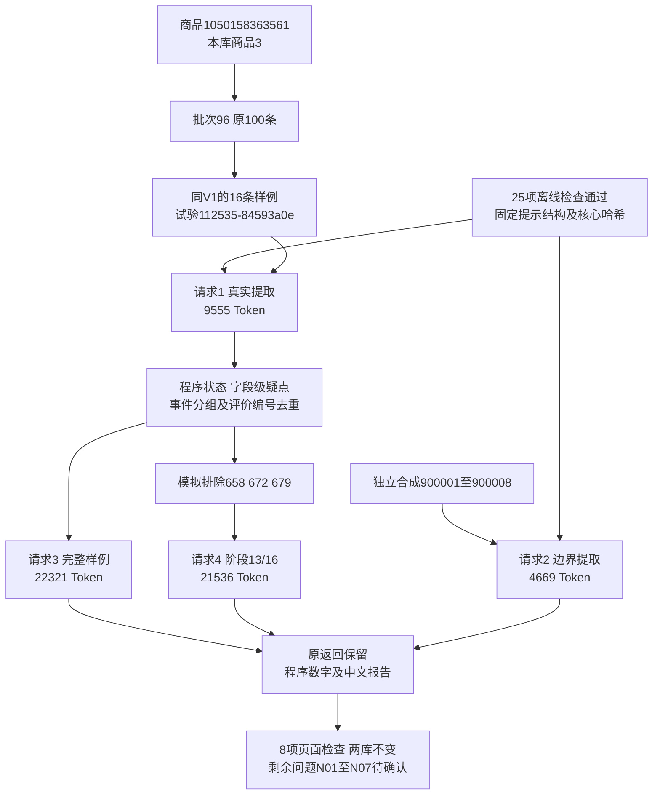

# 评价提示词 V1.1 实施与复测记录

日期：2026-10-30。状态：已按批准完成V1.1修改、离线检查及真实复测，仍有语义问题；没有通过正式接入或用户人工验收。下一版只提出[修改提案](评价提示词V1.2待确认修改方案.md)，未实施。前置范围见[V1.1原方案](评价提示词V1.1问题与修改方案.md)。

## 授权及实现范围

用户允许“执行，离线检查无误后可以真实复测；有问题继续整理方案，确认后修改”。本轮明确沿用同一16条真实评价、8条独立合成以及完整/阶段两份报告，deepseek-flash最多4次，不重试。代码只在tests/prompt_trials，未接入正式Web/CLI、数据库或历史任务。

新增[提取V1.1](../操作参考/评价提示词V1.1/提取.md)、[报告V1.1](../操作参考/评价提示词V1.1/报告.md)及两份完整.schema.json。固定全部子字段、类型、枚举和空值，实际请求附机器结构；服务商仍使用已有json_mode，不声称提供严格schema执行保证。

程序从有效提取和源文字派生整体状态；格式失败/缺失不伪装无法理解。疑点按字段定位，对象未知不自动丢失尺寸/回购表述；事实核心疑点保留线索但不作为确定统计。时间文字必须可在本片段依据逐字定位；任何派生恢复有审计且不改原响应。报告事实/推断分栏，范围与统计卡片由程序填充，按事件归属及评价记录去重，不自动合并同义词。引用存在/关联/语义支持分开，语义始终需复核。

## 离线检查与固定版本

真实请求前25项离线检查通过，offline-tests.log和offline-result.json保存实际结果、核心4文件指纹、日志哈希。覆盖固定结构/枚举、精确引用、局部保留、状态、时间、历史/当前统计、并集去重、阶段隔离、未知及重复身份、严格JSON不修复、引用关联、资料缺失、费用/代码/提示门禁与4次上限。

试验112535-84593a0e，证据根目录workspace/output/reports/review_prompt_v1_1/20261030/112535-84593a0e/。manifest固定提示/结构指纹，代码在复测中未改；额度400000保守Token预留、最多4次。每阶段先独占保存意图，重复阶段/超额/受测代码变化拒绝联网。实际预留合计208488，不是实际费用或用量。

V1证据104216-dbbc52d2保留，原16条与合成8条逐字复用。源商品1050158363561，本库商品3，评价批次96，采集时间2026-10-26 10:11:58；原批次100条达到采集上限。真实观察601、602、603、604、605、610、618、624、646、658、663、672、679、694、696、699，合成900001～900008不是数据库记录。目的性样本不能代表市场或独立买家。

## 四次真实调用

| 次序/目的 | 输入Token | 输出Token | 总Token | response_id |
|---|---:|---:|---:|---|
| 1 真实16条提取 | 3440 | 6115 | 9555 | a1768eee-b684-4413-be43-8d1b04c4dfe7 |
| 2 合成8条提取 | 2911 | 1758 | 4669 | 47151123-c0e7-4d1e-94af-512297009a6c |
| 3 完整样例报告 | 15008 | 7313 | 22321 | ca83bcbc-82c3-4ecd-8ae6-b5e5206c3dc9 |
| 4 阶段样例报告 | 13334 | 8202 | 21536 | 41633ef9-32ba-474f-b0a7-a0ea6121b264 |

实际4次，58081 Token，全部stop、严格JSON可解析。相比V1的46673增加11408，本轮范围相同但结构与信息量变化；不据此宣称整体性价比提升。金额以服务商账单为准，未估价。没有第5次、修复请求或模型切换。

response_id是服务商返回身份，未写入本库analysis_calls，亦没有新增本库analysis_tasks编号。完整原请求/响应及Token均本地保留，未记录密钥。

## 已改善和保持的行为

- 四份返回完整契约与局部关联检查均0错误，真实id保持整数，无类型恢复、引文修复或展示JSON修复；24条返回，真实48/合成9份引文均为精确连续原文。
- 602回购表述进入有效信息，具体对象与时间未知分开；603/604分别保留。
- 合成900001～900003明确未使用，900004已使用；900005初评duration_text=null，追评只复制“用了三次”，保留初追评变化，不再编造初评次数。
- 610张数归历史购买，比较方向不明确，两份报告都明确不能作为当前确定缺陷。
- 699价格满意没有再变成明确购买原因；报告将事实与推断分栏，资料缺口没有再直接写成竞品不透明。
- 658/672/679尺寸满意在对象未知时保留统计；602回购有表述、对象不明也保留，按不明事件范围分组，不当复购率。
- 程序生成完整样例16/16、阶段13/16。阶段模拟排除658/672/679，不提供其内容，报告f4及p2附近说明尺寸缺口，没有把合成或排除三条的原文混入。
- 完整7个发现/2个方向，阶段7个发现/3个方向；同一报告内能说明各方向差别。转述、期望、否定、空白及资料指令边界基本保持。

这些只说明本轮样例表现，不保证其他商品、后续请求或语义全部正确。

## 仍有问题与回归问题

1. 单观点多维度：624把厚度/粘性、清洁/胶印、用量/顺滑等合并，658合并尺寸/便利，663合并用量/厚度。统计可追溯但主题仍混合，影响独立比较。
2. 694的flags说物流明确，uncertainties却把该物流观点fact_text/topic一起标疑，程序按核心疑点排除并派生unclear；局部难懂仍扩大。程序未按关键词擅自推翻AI，不能称为已解决。
3. 900005虽有卡扣断和盖子无法扣紧，explicit_impact全部null，问题→影响对应未完整提取。
4. 900002客服转述产品叠放，source_type转述正确，但target=客服；描述对象和信息来源仍混淆。
5. 900008明确买来收纳餐具，却只标使用场景，漏购买原因；V1曾同时保留，属于回归。
6. 两份statistics.meaning重复写“一条/两条”等；阶段f4/f5正文也有条数样式警示。数量本轮对照已有统计未见新增合计，但没有遵守程序统一展示约定。检查器仅对事实和推断文本作数量样式警示，未覆盖meaning，属于程序覆盖缺口，不能只归咎模型。
7. 完整p2反证关联f1，理由里同时提到一卷用量足；该事实在f5而不在f1。整段发现引用仍不足以证明反证理由支持成立。

完整及阶段报告局部关联检查0项并不覆盖这些语义问题。完整警示0、阶段事实/推断中的统计样式警示2；原模型文本均未自动修改。对应V1.2的N01～N07只形成提案，未调整本轮提示或受测核心后再次请求。

## 数据库和证据核对

正式库与验证库31张业务表逐表数量/有序内容哈希前后一致，版本仍0013_analysis_recovery，业务新增/修改/删除均0；无DDL、原生备注、约束或版本行修改。

| 正式库累计 | 前 | 后 | 新增/修改/删除 |
|---|---:|---:|---|
| products | 495 | 495 | 0/0/0 |
| collection_batches | 155 | 155 | 0/0/0 |
| review_observations | 888 | 888 | 0/0/0 |
| analysis_tasks | 2 | 2 | 0/0/0 |
| analysis_sources | 200 | 200 | 0/0/0 |
| analysis_calls | 2 | 2 | 0/0/0 |
| analysis_details | 190 | 190 | 0/0/0 |
| analysis_reports | 3 | 3 | 0/0/0 |
| 全31业务表行数合计 | 22152 | 22152 | 0/0/0 |

验证库全31表0→0。旧任务0c327dafcdee4fd8945d4f7eca9584d1及aeb7fe644284493eab6b6904f725d1e1保持不变。V1.1结构只属于本地试验文件，不是正式MySQL字段取值契约。

qa核对4份原请求哈希、4份原响应、提示/结构/核心代码固定、V1原证据不变、57份引文、无派生修复、阶段范围、合成隔离、预算/次数、密钥排除及双库不变，均通过。检查器初版直接比较Windows文本文件字节与实际发送文字哈希，因CRLF产生不匹配；仅调整QA按实际UTF-8发送文字核对，未修改核心/提示/原请求或新增AI调用。

4页×1440/390共8项只读浏览器检查通过，无横向溢出、脚本错误、断引用或外部请求；截图和qa.json留本机。页面及结构通过不等于语义通过。核心代码受离线门禁固定，显示层在结果生成后另行验收；线上代码未改，不重启无关8000服务。

## 查看结果

本机证据根目录提供index.html、complete-report.html、partial-report.html、extraction.html，以及quality-review.json的18项内容对照、summary.json、offline-tests.log、qa.json、完整输入/输出和指纹。本地文件供查看，不提交业务原文与密钥。

后续按用户约定先审核V1.2问题提案，再决定修改及新付费复测范围。当前4次授权已用完，不再自动调整或请求。

所有服务商请求身份见上表；本机试验编号关联文件，批次96及评价编号关联真实只读来源，没有新增数据库任务、分析调用或采集批次。
