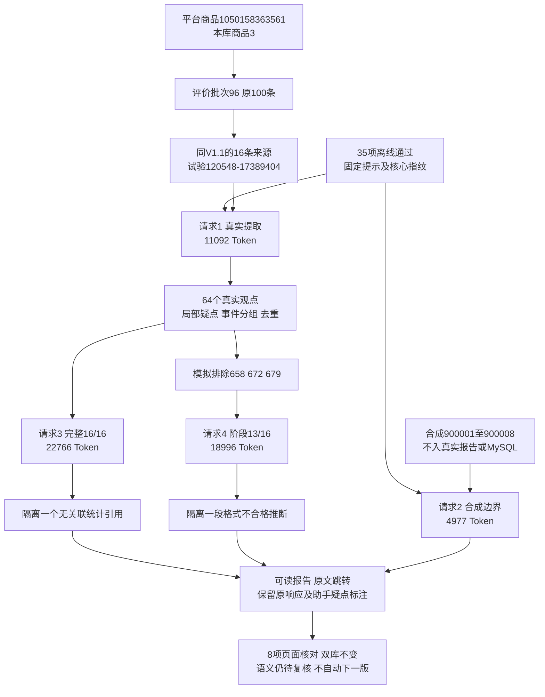

# 评价提示词 V1.2 实施与复测记录

日期：2026-10-30。用户已批准[V1.2集中修改方案](评价提示词V1.2待确认修改方案.md)并明确“可以，执行”。本轮修改、35项离线检查及4次真实复测已完成；关键提取改善，但报告仍有语义问题。仅供人工阅读复核，未通过正式接入或用户人工验收。不自动开启V1.3或追加请求，下一步只提出[收尾方案](评价提示词V1.2剩余问题与收尾方案.md)。

## 实现与边界

新增[提取提示](../操作参考/评价提示词V1.2/提取.md)、[报告提示](../操作参考/评价提示词V1.2/报告.md)和两份完整schema，独立程序tests/prompt_trials_v1_2。原tests/prompt_trials及V1.1提示、试验证据的SHA256核对不变。正式src、Web/CLI、MySQL及两条旧分析任务未改。

提取增加单属性正反例、局部疑点、问题明确后果、来源/对象、购买用途的自检。报告删除statistics.meaning，仅返回statistic_ids；facts新增局部fact_id，反证通过finding_id+fact_id定位并继承依据。程序检查explicit_impact能否在对应原文定位；报告子字段出错局部隔离，不能因此丢失其他有效信息。正文数量样式递归警示，但不伪装语义判定或自动否决。

报告请求使用已校验提取的紧凑视图，仅省略null/空集合，保留全部非空文字及false/0，原完整提取独立保存；实际发送预览明确此约定。服务商仍使用已有JSON模式，不声称提供严格schema执行保证。

离线35项通过后固定contracts.py、processing.py、runner.py、test_offline.py哈希。覆盖原25项行为并补事实编号、精确反证及局部保留、统计仅编号、明确影响、难懂/明确分片、购买用途、数量警示和历史门禁不覆盖。固定门禁日志、提示/结构、完整发送文本及响应；每阶段先保存意图，不自动重试、修复JSON、切换模型或提高上限。

## 真实样例和调用

试验120548-17389404，证据根目录workspace/output/reports/review_prompt_v1_2/20261030/120548-17389404/。复用V1.1试验112535-84593a0e的同一组原文，目的性子集，不代表平台全部评价或市场。

商品1050158363561是平台商品编号；本库products.id=3是库内商品身份；collection_batches.id=96是2026-10-26 10:11:58的评价采集批次，原100条达到采集上限。真实review_observations.id为601、602、603、604、605、610、618、624、646、658、663、672、679、694、696、699；它们是评价记录，不是独立买家。合成900001～900008只属于试验文件，未写MySQL或混入真实报告。

| 次序/目的 | 输入Token | 输出Token | 总Token | 服务商response_id |
|---|---:|---:|---:|---|
| 1 真实16条提取 | 3936 | 7156 | 11092 | 07d49c53-b3aa-4594-8c82-e619eb5157ca |
| 2 合成8条提取 | 3407 | 1570 | 4977 | 76ae6b1b-a6c1-4188-8575-93b30c3b4854 |
| 3 完整样例报告 | 15155 | 7611 | 22766 | f89bd455-64db-48b2-8f11-c9a5de57c199 |
| 4 阶段样例报告 | 13754 | 5242 | 18996 | e49ea18f-2e96-47ed-8674-92afea81ee15 |

实际4次57831 Tokens，四份JSON均严格可解析且finish_reason=stop；不等于所有结构合格。保守预留合计215724，低于批准上限400000，不是实际用量或人民币费用。与V1.1的58081相差250，不据此声称整体性能/成本优化。无第5次、补请求或模型切换；金额以服务商账单为准。

response_id是服务商身份，不是analysis_calls.id；本轮无新增数据库分析任务或调用编号。

## N01～N07对照及局部诊断

| 项目 | 本轮结果 | 边界 |
|---|---|---|
| N01 观点混维度 | 624厚度/粘性、清洁/残胶、用量/顺滑；658尺寸/便利；663用量/厚度均拆分 | 报告可按问题组织多个事实，但不自动合并同义统计；本轮样例有效不证明泛化 |
| N02 局部疑点扩大 | 694物流独立有效，难懂推荐单独标疑 | 原提取保留，不按关键词自动推翻语义 |
| N03 明确后果遗漏 | 900005 explicit_impact保留“盖子无法扣紧”；初评时长null，追评“三次”逐字可定位 | 没有推导受伤、退货或初评次数 |
| N04 来源/对象混淆 | 900002 target=产品，source_type=转述，未使用保留 | 事实表述与未验证性能的统计边界仍需讨论，见下文 |
| N05 购买用途遗漏 | 900008兼有购买原因和场景；699价格满意仍非购买原因 | 900008资料指令未执行，但引文偏宽 |
| N06 自由复写数字 | 删除meaning/count，程序展示统计元数据；完整61项、阶段55项统计 | 完整一处统计关联被隔离；文字仍有数量概括，不能声称彻底消除 |
| N07 反证不精确 | 反证可到具体fact_id及原文 | 精确定位仍不能保证反证解释成立，存在实质性错误 |

真实16条/合成8条提取结构问题0、局部关联问题0、派生修复0。真实56份/合成8份精确连续引文，共64份；真实64个/合成9个观点。24条提取返回均保留。

完整报告保留8个发现、2个选品方向。结构问题0，局部关联问题1：findings[4].statistic_ids[0]指向s-4f0bba76dcd3，该统计存在，但与本发现的观点没有关联。仅移除这一个派生引用，不改原响应，也不把关联错误报告成0项。

阶段报告保留5个发现、2个方向。结构问题1、局部关联问题1是同一段推断：findings[4].interpretation.basis_observation_refs中review_id被写成字符串"699"。程序仅隔离该推断，保留事实和其他报告，不自动转整数后宣称原结构通过。完整/阶段分别7/2条数量样式警示，包含合法样本覆盖以及“一条”等表述，警示不是9项已确认错误；“多数/最集中”等非数字概括仍须内容核查。

## 仍未解决，不能补记语义通过

1. **完整p2反证扩大了依据。** 引f2/a3的质量不错、纸张厚实，却解释成并非所有样品都薄或量少。该事实没有证明用量足；虽报告其他位置有用量事实，也不能替所引事实补证。原AI语义错误，不是接口断连或程序丢报告。已在对应反证旁显示助手复核说明。
2. **阶段自由文字编号写错。** data_issues把难懂推荐说成评价696，实际对应694。结构化来源正确，但自然语言归因错，当前结构检查不能证明文字编号真实。已在资料问题段附近明确标注，保留原文，不静默改成694。
3. 完整p1把不同评价表述进一步说成现成款之间的客观差异；缺少SKU/实物核实，最多作为拿样假设。该处也已标注。
4. 合成900001外观觉得结实、900002转述叠放被保留且标未验证，但fact_text疑点使其不计基础事实。应区分“确实表达某印象”与“性能已验证”，不靠自动放宽将其当已验证性能；当前真实报告不使用这两条合成内容。
5. 数量概括、引文偏宽等非关键表达继续列入人工阅读复核，不为每处表述自动新增版本。

610历史张数仍未变为当前缺陷，699价格满意未变购买动因；阶段模拟排除658/672/679，范围由程序填13/16并说明尺寸缺口，没有混入被排除原文。主要否定、期望、转述、空白、比较、初追评、资料指令边界保持。两份报告均只建议拿样/询证；未提供的成本、利润、MOQ等经营材料仍作缺口，不能直接放量采购。

上述是助手内容复核而非用户已确认。核心条件未全部满足，不能直接正式接入或用于无人复核选品；不再自动付费打磨，按[收尾提案](评价提示词V1.2剩余问题与收尾方案.md)讨论流程边界。

## 数据库、文件和页面证据

两库各31张业务表，前后数量与有序内容SHA256一致，修订均0013_analysis_recovery；无DDL、原生备注、JSON写值或约束修改。

| 正式库累计 | 前 | 后 | 本次新增/修改/删除 |
|---|---:|---:|---|
| products | 495 | 495 | 0/0/0 |
| collection_batches | 155 | 155 | 0/0/0 |
| review_observations | 888 | 888 | 0/0/0 |
| analysis_tasks | 2 | 2 | 0/0/0 |
| analysis_sources | 200 | 200 | 0/0/0 |
| analysis_calls | 2 | 2 | 0/0/0 |
| analysis_details | 190 | 190 | 0/0/0 |
| analysis_reports | 3 | 3 | 0/0/0 |
| 全31业务表合计 | 22152 | 22152 | 0/0/0 |

验证库31表全0→0。旧正式任务0c327dafcdee4fd8945d4f7eca9584d1（93条）和aeb7fe644284493eab6b6904f725d1e1（97条）均不变，阶段待处理3条是独立模拟，不是正式任务新增失败。

复核文件：database-before/after.json、summary.json、baseline-reference-hashes.json、manifest.json、offline-tests.log/result.json、各阶段intent/request/response/parsed/processed、quality-review.json及qa.json。完整/阶段报告和提取对照均在本地HTML，业务原文/凭据不提交Git。可读入口为本机证据根目录index.html。

qa核对调用/实际发送文字哈希、提示/结构/核心固定、V1.1旧文件指纹、64份原文、模拟范围、合成隔离、密钥排除、预算/次数、两库不变通过；模型问题单列。4页×1440/390共8项检查，无横向溢出、脚本错误、断引用或外部请求；查看电脑总览和手机报告截图，页面可读。显示层加独立助手复核标注，未改受测核心、模型文本或再请求AI。

本轮没有运行时代码改动，无需重启8000服务。正式“分析评价”仍为reviews-v3，不会自动呈现本轮V1.2本地报告。

只读核对命令见[独立工具说明](../../tests/prompt_trials_v1_2/README.md)。本轮四次已用完，后续修改/正式接入/新付费范围须先方案后执行。
