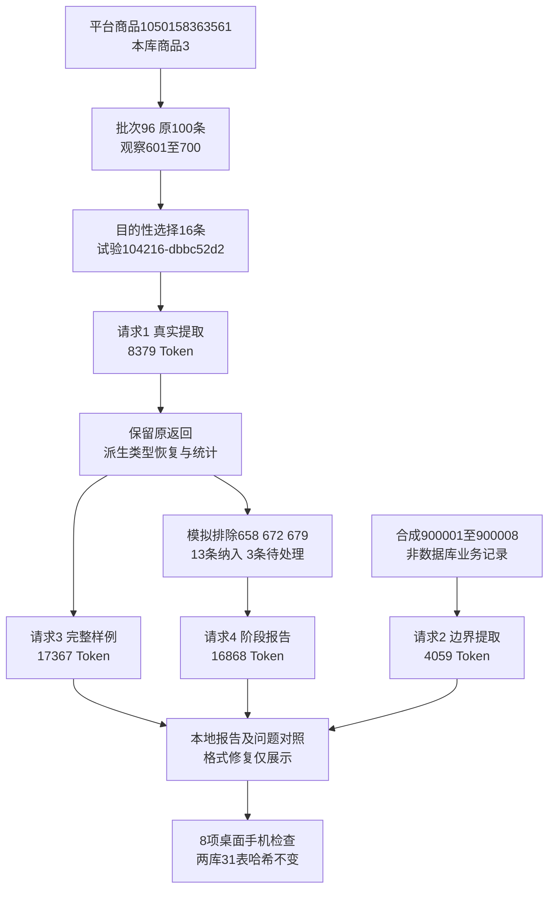

# 评价提示词 V1 样例验证

用途：记录两套提示词最多4次真实DeepSeek请求的结果。快照：2026-10-30。状态：试验已完成，存在格式和内容问题，未通过正式接入或用户人工验收。进度只维护在[验收清单](../功能逐项验收清单.md)。

## 范围与来源

经营方式为优先采购现成款，其次包装组合，拿量后再考虑定制。用户确认[提取V1](../操作参考/评价提示词V1/提取.md)及[报告V1](../操作参考/评价提示词V1/报告.md)，明确允许16条真实评价、8条合成边界样例、完整及阶段报告，最多4次请求，不自动重试。

这是独立提示词试验，没有替换线上reviews-v3、正式页面、MySQL契约或旧任务，没有重新采集。无表列、字段取值、原生备注和迁移变更；V1结构仅用于本地文件，字段说明在提示词中。

- 平台商品1050158363561，本库products.id=3，批次96，采集于2026-10-26 10:11:58；原批次100条，达到采集上限，不是平台全部评价。
- 真实16条：601、602、603、604、605、610、618、624、646、658、663、672、679、694、696、699。有目的选样，不具有随机代表性。
- 合成900001～900008为另一收纳盒测试背景，未使用、转述、期望、否定、初追评、空白、比较取舍及资料指令分别验证；不是真实数据库编号，不混入报告。
- 试验编号104216-dbbc52d2。根目录：workspace/output/reports/review_prompt_v1/20261030/104216-dbbc52d2/。
- manifest.json固定提示SHA256、范围、模型、最多4次意图和400000 Token保守预留。每次先独占保存intent，已有阶段拒绝重发。单次输出上限16384/12288/16384/16384；预留不是费用金额。
- 本机脚本：workspace/review_prompt_trial.py、workspace/render_review_prompt_trial.py、workspace/check_review_prompt_trial.py。脚本和业务证据均在Git忽略目录；原文、原始请求/响应、用量及派生展示只留本机，无密钥或数据库密码。

## 实际调用

| 次序 | 内容 | 输入Token | 输出Token | 总Token | 服务商response_id |
|---|---|---:|---:|---:|---|
| 1 | 真实16条提取 | 2904 | 5475 | 8379 | 92f4731e-adb9-4b3a-a8ce-c3257aa8c403 |
| 2 | 合成8条提取 | 2375 | 1684 | 4059 | f7ee97fd-0308-4a25-a5b7-3b68d9503f46 |
| 3 | 完整样例16/16报告 | 10661 | 6706 | 17367 | b2b2af54-457b-4101-91a8-76c3be212006 |
| 4 | 阶段样例13/16报告 | 9604 | 7264 | 16868 | e963be8e-069e-47dc-8bf4-efbf64b2ccac |

均为deepseek-flash，finish_reason=stop。实际4次、46673 Token，没有第5次、自动重试或模型切换；人民币费用以账户账单为准，未估算。response_id是服务商返回编号，不是MySQL的analysis_calls.id；本轮没有新增分析调用行。

## 结果与问题

24条均返回、24份引文均逐字连续；603/604分别保留。658/672/679均提取为尺寸信息，没有直接扩成安装兼容。合成的否定、转述、期望、空白和初追评变化基本区分，资料指令未执行。但这些表现不足以判定整体通过：

1. 真实16条id均从整数变成字符串。严格原检查保存为real_extract-strict-validation.json；派生副本仅按唯一逐字编号匹配恢复类型，16次逐项记录，原始返回不变，不算原输出类型合格。
2. 602有回购经历却general_only；694有有效物流信息却整体unclear；900001有具体外观和未使用信息却general_only。
3. 900001～900004使用阶段漏填；900005初评时间字段增加原文没有的“用了几次”。初追评关系虽保留，不能整项判通过。
4. 第一套对usage_stages、relations只给中文含义，未固定子键；实际生成usage_time_text/time_or_count等不同字段名，需要完整结构契约。
5. 610过去购买张数反馈的comparison.difference误写成当前比过去少；虽有对象疑点，完整报告摘要和F07仍作为当前确定负面。
6. 完整F02把699“经济实惠”作为明确购买动因；阶段F02也将价格敏感推断混入评价事实。
7. 完整F11把未知SKU资料说成竞品规格不透明；自行汇总2条负面/3条正面，程序未提供该并集统计。缺少资料不能变成商品缺点。
8. 引用存在不等于支持成立：完整F10谈回购却引用type-005笼统表态、topic-031笼统品质认可等；阶段O2把F14同时作为支持与反证而未解释反对逻辑。
9. 完整报告字符9988处有未转义引号，严格JSON失败。仅在展示副本加一个转义符后可解析，原响应和修复前后SHA256均保留；展示修复不算原格式通过。
10. 阶段F10/F14/F16的evidence_strength=个别反馈，超出约定三值；应写入解释，不能改变枚举。

完整展示副本14个发现/3个方向，阶段原返回17个发现/3个方向。报告保留成本和供货缺口，建议拿样或补资料，没有宣称利润或建议批量采购；其中次数、样品数量和组合数量属于行动建议，不是市场统计。

阶段试验模拟排除658/672/679：原16条中纳入13、待处理3，输入不提供被排除三条的内容。报告scope及尺寸发现F12/F13附近说明缺失影响，不引用缺失原文。这不是正式任务aeb7fe644284493eab6b6904f725d1e1再次执行或新增失败。

统计试验也有局限：按同名主题/倾向/信息类型及评价编号去重，不自动合并同义词；整个观点uncertainty非空就不计入。对象不明仍可能有可靠尺寸/回购信息，这种过滤会丢失确定部分，正式接入需细分疑点作用范围，不能归咎于AI。没有通过固定主题语义规则放宽或否决原返回。

## 数据库前后核对

两库版本保持0013_analysis_recovery。31张业务表逐表行数及有序全内容哈希前后一致，业务行新增/修改/删除均0，版本行未写入；表列、备注、索引和约束未修改。

| 正式库表 | 本轮前累计 | 本轮后累计 | 新增/修改/删除 |
|---|---:|---:|---|
| products | 495 | 495 | 0/0/0 |
| collection_batches | 155 | 155 | 0/0/0 |
| review_observations | 888 | 888 | 0/0/0 |
| analysis_tasks | 2 | 2 | 0/0/0 |
| analysis_sources | 200 | 200 | 0/0/0 |
| analysis_calls | 2 | 2 | 0/0/0 |
| analysis_details | 190 | 190 | 0/0/0 |
| analysis_reports | 3 | 3 | 0/0/0 |
| 全部31张业务表合计 | 22152 | 22152 | 0/0/0 |

验证库31表均0→0。database-before.json/database-after.json保存只读数量及内容指纹，summary.json汇总调用。旧任务0c327dafcdee4fd8945d4f7eca9584d1、aeb7fe644284493eab6b6904f725d1e1及采集资料保持不变。

## 查看方式与验收边界

证据根目录下提供：index.html验证首页；complete-report.html完整展示；partial-report.html阶段展示；extraction.html原文对照；quality-review.json共20项内容复核。复核者是本轮助手，不等于用户人工验收，不计算无依据的模型准确率。

qa.json和8张截图记录四页在1440/390宽度的检查：无横向溢出、页面错误、断开的依据锚点或外部请求。离线核对4次意图/返回、用量、提示哈希、24条编号/引文、格式修复审计、合成隔离、阶段范围、密钥排除及两库不变均通过。页面和证据检查通过不代表模型内容通过。

无线上代码变更，未运行无关全量测试，也未重启不受影响的8000服务。V1未通过正式接入验收，下一步先讨论V1.1：固定子结构、明确时间/对象、区分缺失与反证、约束统计支持性、细分疑点范围；没有剩余付费调用授权。

批次表示真实来源范围，16条是验证子集；服务商响应、本机试验及数据库任务编号是不同身份。图中没有新增MySQL任务或采集批次，样例报告不能替代正式100条报告及用户验收。
