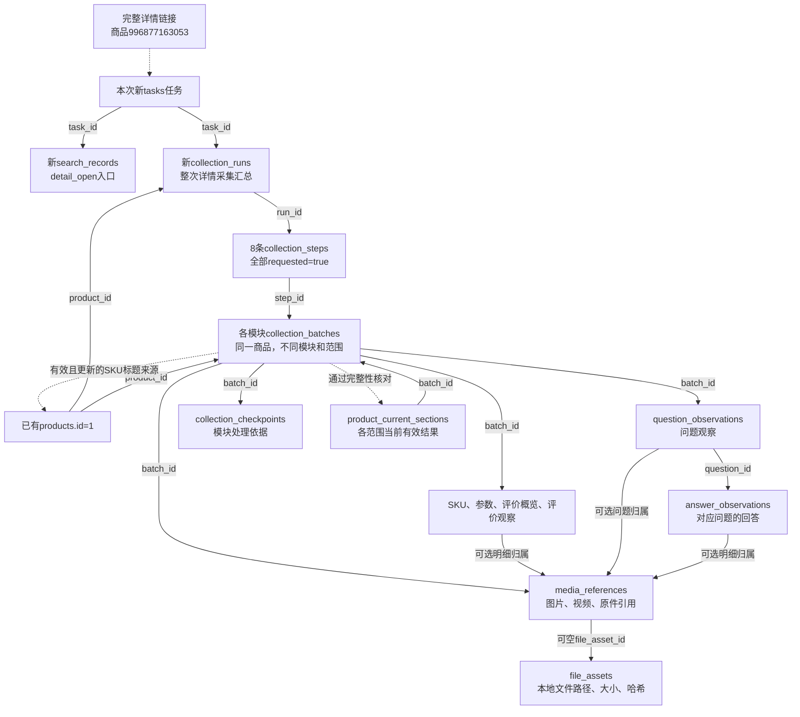

# 详情页默认全模块联合采集测试方案

日期：2026-10-24，北京时间。状态：用户已确认执行。首轮主图4/5因日志确认文件并发占用中断，修复后8模块已于12:45:52结束，运行4为complete_with_warnings；新主图批次8已核对5/5，SKU如实保留2项不可选且价格未确认警告。全部等待用户逐模块人工核对，浏览器保留。

执行前基线：2026-10-24 11:40:07，22张业务表、23张总表、283字段、49外键及中文备注核对正常，无活动任务或待补写；18份旧原件登记校验值，商品根汇总JSON单独登记。新任务dfd4eff50123420fb52619b79d279503开始于11:40:16.959335，默认评价上限100、问题上限50，未传--all或单模块开关。

修复后复测基线12:24:11，原任务及旧批次保留；复测任务a16dab28e34249b581d6f8651c3d63ed于12:24:16.731866开始，运行4、步骤25至32全部启用。主图批次8从旧批次6校验复用4张并补采1张，当前主图指向8；[真实原因、流转图和SQL](主图采集中断排查报告.md)。

实际结果：视频1份、主图5张、SKU35项/33项价格/35张图、参数6项、详情29图、评价概览5000+及7标签、评价100条、问答25题123回答。评价按100上限结束；问答按可见末尾结束，问题上限仍50。86新文件、27旧原件、155规范快照及13组只读SQL核对通过；[完整结果、逐表增量和真实关联图](../workspace/output/reports/manual_acceptance_20261024/08_default_detail_20261024_122411.md)。

## 目标及本次范围

按用户最新要求，将下一轮调整为同一商品的一次默认全模块联合采集，保留程序默认数量上限，替代上一版取消评价和问题上限的方案。继续使用商品996877163053，现有数据库身份products.id=1，通过完整链接https://detail.tmall.com/item.htm?id=996877163053进入，便于与第06、07项记录对照。

原清单第08至15项涉及的详情模块及组合流程在本轮一起验证。执行时按实际结果逐模块登记完成、部分完成、阻断、未执行或待人工确认；用户确认具体模块后才标为通过，不能因启用全模块就将这些项目全部勾选通过。

当前已有的采集数据及历史文件保留，用于核对同商品重复采集及有效结果切换。数据库正式库仍为taobao_automation，表结构版本0003_search_origin。本次使用已有功能，不计划更改表结构或Web页面。

## 默认方式与拟执行命令

已核对本地CLI及业务代码：未指定任何单独功能参数时，默认选择全部8个详情模块。本轮不传--all，保留最多100条有效评价、50个问题的默认数量上限；不传--parameters等单模块开关。

用户确认后，拟在项目目录执行：

```powershell
.\.venv\Scripts\python.exe main.py taobao detail --input "https://detail.tmall.com/item.htm?id=996877163053"
```

本次不传任何单模块开关，因此8模块均启用；不传--no-wait，采集结束后保留窗口供人工查看。评价批次requested_limit预计为100、问题批次为50，两者mode为limited，对应数据库collection_mode=limited；每个已选问题的回答仍不设条数上限，answer_limit为空。实际字段以新批次记录核对，不能提前假定运行成功。

数量不足默认上限时，以平台当前可见内容及末尾核对结果为准；达到上限时明确记录limit_reached。100条限制有效评价数量，模板跳过等扫描记录另行统计；50限制问题数，不是回答总数。评价、问题的scope_key包含mode和requested_limit，不能将限定范围结果当成无上限全量。

“全部”指已实现模块内、当前登录账号实际可见且可读取的内容。评价会按现有规则跳过模板好评，保留扫描及跳过统计；商家回复当前未采集。评价、问答中的图片/视频只保存来源链接，不下载媒体文件。主图视频目前支持普通MP4直链，实际不支持的格式应记录原因，不能报为下载成功。

## 固定执行顺序与存储去向

| 顺序 | 模块 | 采集内容 | 主要业务存储 |
|---|---|---|---|
| 1 | video | 主图区域视频及实际有无视频依据；支持格式下载 | collection_batches、media_references、file_assets |
| 2 | main_images | 图集全部主图、顺序、原链接及本地原图 | collection_batches、media_references、file_assets、collection_checkpoints |
| 3 | skus | 商品标题、售出提示、规格组合、价格、可选状态及SKU图片 | collection_batches.result_payload内product_info、sku_observations、media_references、file_assets、collection_checkpoints；products标题来源可能更新 |
| 4 | parameters | 商品参数名称、完整值、顺序及原HTML | collection_batches、parameter_observations、media_references、file_assets |
| 5 | detail_images | 图文详情全部图片、顺序及原HTML | collection_batches、media_references、file_assets、collection_checkpoints |
| 6 | review_summary | 评价数量原文及口径、好评率、总结标签 | collection_batches、review_summaries |
| 7 | reviews | 最多100条当前可见的有效评价正文、规格、追评、媒体链接 | collection_batches、review_observations、media_references、collection_checkpoints |
| 8 | questions | 最多50个当前可见问题、逐题可见回答、回答归属及完整性依据 | collection_batches、question_observations、answer_observations、media_references |

各模块还会登记实际存在的原始JSON、HTML、CSV等证据文件；不是每个模块都会产生全部文件类型。截图是入口证据，不代表已核对后续全部模块。

## 执行前和执行中的核对

1. 用户确认方案后，先结束当前保留的第07项浏览器任务并核对日志入库，释放同一浏览器资料目录的任务锁。按实际结果记录结束状态，已保存的批次3、4及参数历史保留。
2. 在新任务启动前记录22张业务表的数量，以及商品1、批次3和4、参数观察、当前分区、标题来源的完整字段；登记旧历史文件哈希。商品根JSON属于可更新汇总导出，单独登记，不能当成不可变历史文件。
3. 记录当前结构、中文备注、时间口径及待补写情况；有未完成写入先处理，不并发使用同一套淘宝浏览器资料。
4. 通过统一执行器启动一次详情任务，复用登录状态，按上述固定顺序串行运行8模块。一次任务建立一个运行汇总和8条模块步骤；各模块产生自己的批次。进度更新、部分尝试或复核可能让实际批次数量超过8，不能把保存事件数当成批次数。
5. 每个模块保存原件、规范快照、对应观察/媒体/检查点并核对入库。各模块分次保存，整次全模块采集并非一次覆盖8模块的数据库事务；前序已确认保存的数据在后续阻断时仍保留。
6. 完整性核对通过的模块，才新增或更新同商品、同分区、同scope_key的有效指针。不同范围保留不同指针，不能理解为全商品只有一个最新批次。
7. 遇到验证、未知页面结构、未确认价格、下载失败或其他阻断时保留现场并等待处理。允许继续的SKU警告按现有规则记录partial，整体可为complete_with_warnings，但不会把部分SKU当成完整有效结果发布。未到达的模块标明未执行。
8. 评价最多100条有效记录，问题最多50个；不足上限时依据平台实际可见末尾及模块证据结束。达到上限是本次限定采集范围完成，不表示平台内容已全部采完；不足上限且无法确认末尾时记录真实状态，不用页面概览数量强行补齐。每题的可见回答需处理完才计为该题完成。过程中如需停止，保留已保存结果并说明未完成范围。

## 预计新增和修改的数据

| 数据表 | 预计变化及核对重点 |
|---|---|
| tasks、task_events | 新任务、阶段日志、人工提示及最终实际状态；日志序号连续，结束后无待补写 |
| search_records | 新增本次detail_open入口；通过task_id和product_id与本次运行追溯，没有search_records到collection_runs的直接外键 |
| collection_runs、collection_steps | 本次运行汇总及8个启用步骤；核对module、requested、status和continuation_allowed |
| collection_batches | 每模块新批次及实际过程状态；核对task_id、product_id、run_id、step_id、scope_key、数量和覆盖口径；评价/问题核对collection_mode=limited、requested_limit=100/50；旧批次的内部导出/最后尝试选择标记可能变化，须列出实际字段前后值 |
| sku_observations、parameter_observations、review_summaries、review_observations、question_observations、answer_observations | 按模块实际结果新增观察；回答必须关联本批次的正确问题，历史批次观察保留 |
| product_current_sections | 新模块/范围新增指针；已存在同范围则更新。参数若完整且范围未变，预计从现有批次4切换到本次真实参数批次，编号采集后报告 |
| products | 复用商品1，不因重采重复创建；SKU若提供有效且更新的标题来源，display_title和title_source_batch_id可能更新，即使标题文字相同，来源也可能推进，报告实际前后值 |
| media_references、file_assets | 按实际链接、下载文件和证据登记；区分link_only、downloaded等实际状态以及没有本地文件的媒体链接 |
| collection_checkpoints | 按模块记录评价去重、SKU项、图片项等处理依据；检查点不代表所有模块都具有自动断点续跑能力 |

本次直接进入详情，不生成新的列表观察，也不从旧“粘毛器”列表强行复制搜索来源。search_method、search_keyword等字段按真实来源填写；不新增历史导入记录。

## 计划数据流转图

以下为计划逻辑示意，只有products.id=1为已有真实身份；新任务、运行、步骤和批次编号均待执行后填入。虚线表示程序逻辑，带字段名的实线表示字段关联；箭头不表示写入时间。



## 采集后的交付和人工确认

- 给出完整任务编号、运行编号、8步骤及所有实际批次编号、北京时间；为每个模块单独报告结果与未覆盖分支。
- 列出每张表本次新增、修改、删除数量和累计数量；原行修改逐字段给前后值，包括标题来源、当前参数指针及旧批次内部标记。
- 按页面、原始文件、规范快照、数据库交叉核对数量、顺序、归属、字段值和文件校验值；评价/问答的默认数量范围、实际停止原因与人工抽查范围分别说明。
- 用本轮真实编号替换示意，提供整体关联图及各模块流程图、只读SQL和字段快照。至少串起一条SKU、一条参数、一条评价、一组问题/回答及一份媒体文件；实际无内容的模块提供明确证据，不编造例子。
- 为每个模块说明核心字段、状态、空值和覆盖范围；发现新取值解释时同步维护数据库字段取值说明.md。数据库关系说明仅在实际关联或含义发生变化时同步修订。
- 浏览器保留，先展示整体结果，再按模块解释数据流转并回答问题。只有用户确认对应模块没有问题后才标记通过，不自动进入下一轮采集。

本方案已由用户确认执行并完成程序及原件核对；当前保留浏览器等待用户逐模块确认，不自动进入下一轮采集。
