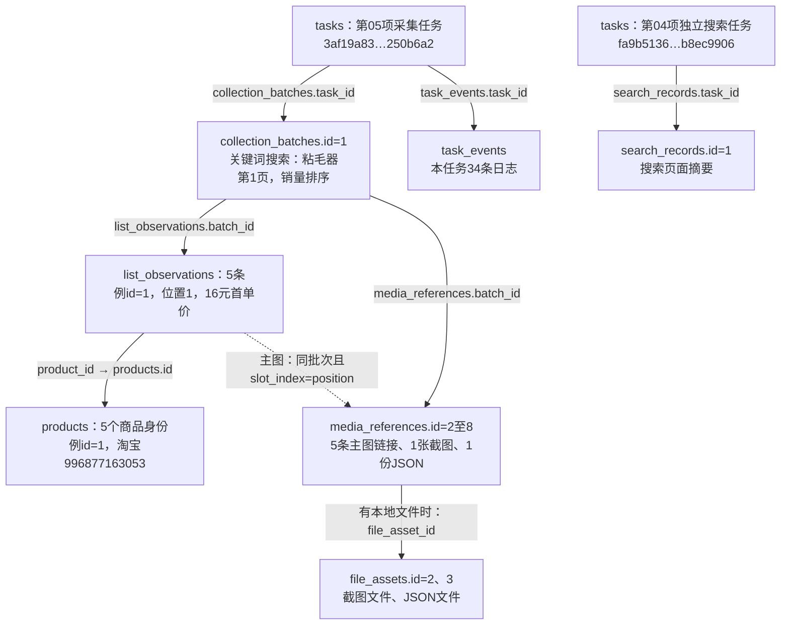
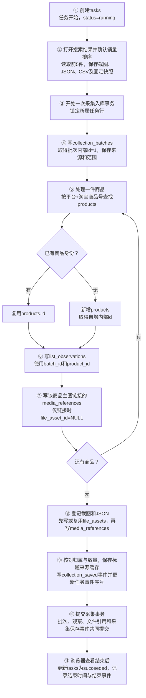

# 列表采集数据流与表关系图

用途：使用真实批次解释列表采集表关系。案例时点：2026-10-23第05项首次限定5条；不是2026-10-24前8条重测的编号。当前进度统一见[功能验收清单](../功能逐项验收清单.md)。

当前0005版本的18张业务表总图、字段速查及列表到详情真实链路，见[数据库数据流转图](../数据库数据流转图.md)。下文继续保留早期列表案例。

使用第04、05项真实记录说明当前程序的关联和写入顺序。数据库版本为0003_search_origin；本图不触发新采集或修改数据库。

## 真实编号

| 对象 | 实际值 |
|---|---|
| 第05项列表采集任务 | tasks.id=3af19a83cb314f54919b4cf34250b6a2 |
| 第05项采集批次 | collection_batches.id=1；source_batch_key=3af19a83cb314f54919b4cf34250b6a2-694d54a9 |
| 本批来源 | search_method=keyword，search_keyword=粘毛器，page_number=1，sort_label=销量 |
| 第一件商品 | products.id=1；platform=taobao；platform_product_id=996877163053 |
| 第一条观察 | list_observations.id=1；batch_id=1；product_id=1；slot_index=1；价格16元首单价 |
| 本批5条观察 | list_observations.id=1至5，各自对应products.id=1至5 |
| 本批商品主图引用 | media_references.id=2至6，role=list_image，link_only，无本地文件编号 |
| 本批截图引用 | media_references.id=7 → file_assets.id=2 |
| 本批JSON引用 | media_references.id=8 → file_assets.id=3 |
| 第05项任务事件 | 34条，归属上述task_id |
| 第04项独立搜索任务 | tasks.id=fa9b513663cc405f8e06f6f2b8ec9906 |
| 第04项搜索摘要 | search_records.id=1；keyword=粘毛器；search_method=keyword |

第05项原采集先于来源升级；独立来源列随后按原证据回填。以下写入流程描述当前程序，新任务会自动填充来源列；图中的编号对应本轮已保留记录。

## 表如何关联

本图箭头表示记录之间的对应关系，字段名称表示实际外键位置，不表示时间先后。实线为外键关联；虚线为程序维护的逻辑关联。

| 子表字段 | 父表字段 | 关系与含义 |
|---|---|---|
| collection_batches.task_id | tasks.id | 一个任务可关联多个采集批次 |
| list_observations.batch_id | collection_batches.id | 一批次有多条列表观察 |
| list_observations.product_id | products.id | 同一商品可被多批次、多位置观察；指向内部商品身份 |
| media_references.batch_id | collection_batches.id | 一批次可以有多个媒体或证据引用 |
| media_references.file_asset_id | file_assets.id | 一文件可被多处引用；仅链接时为空 |
| task_events.task_id | tasks.id | 一个任务有多条过程事件 |
| search_records.task_id | tasks.id | 独立搜索或入口摘要归属实际任务 |

商品主图引用与某条列表观察没有list_observation_id外键；本批次由batch_id相同且position等于slot_index对应。例如观察id=1对应主图引用id=2，二者位置均为1。

search_records与collection_batches之间没有直接外键。第04项和第05项是不同任务，即使都搜索粘毛器，也不能将search_records.id=1当作第05项的父记录。独立搜索会写搜索摘要，列表采集直接写批次和观察。

本批次collection_batches.search_image_file_id与search_records.search_image_file_id均为空；两个字段已有到file_assets的外键，但这次没有实际输入图片关联。以图搜图实际执行尚未接入。

## 当前关键词列表采集的写入先后

关键顺序是：任务先存在；列表批次先于列表观察；每件商品先取得products内部编号，再写该件观察。程序逐件处理，并非先一次创建全部5个products后再一次创建全部观察。

截图、JSON、CSV文件先保存到本地，之后再登记数据库文件索引；“文件已存在”和“file_assets已有索引”是两个时间点。本流程只给截图和JSON建立本地文件索引，CSV保留为导出文件；5个商品主图只保存链接。

批次、列表观察、文件索引/引用和collection_saved事件处于同一个采集事务，提交后才作为这一轮已保存结果可查询。普通运行日志会在各步骤持续记录，不是所有task_events都等到最后才写入。

任务最终状态晚于采集结果保存：浏览器保留供查看期间tasks可以是running，而批次和商品观察已经保存。第05项最终succeeded，本任务共34条日志。

## 单独搜索的写入顺序

单独搜索不会自动创建products、collection_batches和list_observations。搜索页面摘要与真正采集商品明细分别保存。

## 如何读取第一件商品的来源

查询起点可以是list_observations.id=1：通过product_id=1取得products中的淘宝商品996877163053；通过batch_id=1取得搜索方式keyword、搜索词粘毛器、第1页和销量排序，再通过批次task_id查对应任务和日志。

各表内部id分别生成。观察id、商品id、批次id这次恰好有相同数字，真实关联以字段外键为准。
